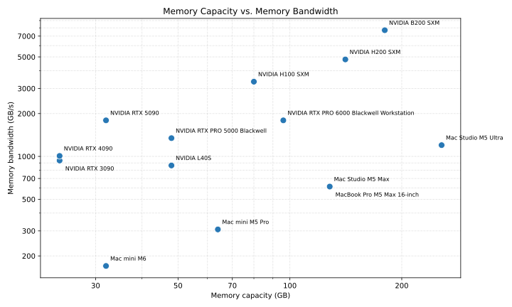
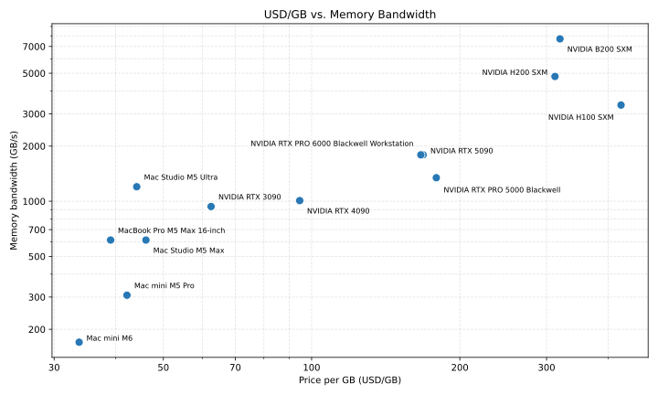

# Local LLM inference hardware

## Important Hardware Parameters

For **local** large-language-model inference, two hardware numbers dominate almost everything else:

1. **Memory capacity** — how large a model (and KV cache) you can keep resident.
2. **Memory bandwidth** — how fast weights can be streamed for autoregressive decode (tokens/s).

Peak FLOPS still matter for **prefill** (prompt processing), but day-to-day chat speed is usually **bandwidth-bound**: each new token re-reads most of the model. Price per GB of memory is a useful value metric when comparing machines that differ wildly in list price.

---

## Model size, quantization, and comfortable RAM

Open-weight models cluster around a few practical size classes. Quantization trades quality and speed for fit:

| Quantization | Rough bytes / parameter | Typical use |
| --- | --- | --- |
| FP16 / BF16 | ~2 | Reference quality; training / shortlist of large cards |
| FP8 | ~1 | Newer GPUs / stacks with native FP8 |
| Q8 | ~1 | Near-lossless GGUF / similar |
| Q5 | ~0.65–0.7 | Good quality / size trade-off |
| Q4 | ~0.5–0.55 | Default local sweet spot |
| Q2 | ~0.25–0.35 | Fit-at-all-costs compromise (GGUF Q2_K / IQ2-class); quality loss is real. Q3 exists but is less common than Q4, so this doc jumps to Q2 as the low end |

The table below is **liberal but intentional**: sizes are round “classes,” not exact Hugging Face IDs, and **comfortable RAM** means weights **plus** headroom for a useful KV cache, runtime, and OS/GPU overhead—not the bare weight file on disk. Long context (32k+), big batches, or MoE routing overhead need more. MoE models are sized by **total** stored parameters (all experts), not active params per token.

**Comfortable RAM (GB)** by model class × quantization:

| Model class (params) | Examples (illustrative) | FP16 | FP8 | Q8 | Q5 | Q4 | Q2 |
| --- | ---: | ---: | ---: | ---: | ---: | ---: | ---: |
| ~10B | Llama-class 8B, Gemma 9B, Qwen ~7–14B | 24 | 14 | 14 | 10 | 8 | 5 |
| ~30B | Qwen/Gemma ~27–35B | 70 | 40 | 40 | 28 | 22 | 12 |
| ~70B | Llama 70B, Qwen 72B, Kimi-Dev-72B | 160 | 95 | 95 | 65 | 48 | 28 |
| ~120B | gpt-oss-120b (~117B MoE), Mistral Large 2 (123B dense) | 280 | 160 | 160 | 110 | 85 | 48 |
| ~400B | Llama 405B–class dense | 900 | 520 | 520 | 360 | 280 | 160 |
| ~670B MoE | DeepSeek-V3–class (total experts) | 1500 | 850 | 850 | 600 | 450 | 260 |
| ~816B MoE | Muse Spark Open (816B total / ~42B active) | 2100 | 1100 | 1100 | 720 | 560 | 320 |
| ~1T MoE | Kimi K2 (1.04T total / ~32B active) | 2700 | 1400 | 1400 | 920 | 710 | 410 |

Rule of thumb used here:  
\(\text{comfortable GB} \approx 1.3 \times N_{\text{params}} \times \text{bytes/param}\), rounded up to a practical install size. Treat the cells as **planning numbers**, not guarantees. Meta quotes ~1.65 TB BF16 / ~537 GB NVFP4 **weight** footprints for Muse Spark Open and suggests ≥2 TB / ≥700 GB VRAM respectively—our Q4 cell is a bit tighter than that NVFP4 floor; prefer ~700 GB+ in practice for 4-bit Muse Spark.

### What fits on which hardware

Capacity is from `hardware.csv` (VRAM or unified memory). Multi-GPU rows assume the model can be split (e.g. llama.cpp / vLLM / TensorRT-LLM style); effective bandwidth and complexity are worse than a single large pool of the same size.

| Hardware | Memory | Comfortable targets (planning) |
| --- | ---: | --- |
| Mac mini M6 | 32 GB | ~10B up to Q8/FP8; ~30B at Q4 (tight) or Q2 |
| Mac mini M5 Pro | 64 GB | ~30B up to Q5/Q8; ~70B at Q4; ~120B at Q2 |
| GeForce RTX 3090 / 4090 | 24 GB | ~10B up to FP16; ~30B at Q4–Q5; ~70B at Q2 (tight) |
| GeForce RTX 5090 | 32 GB | ~10B FP16; ~30B Q5–Q8; ~70B Q4 (tight) or Q2 |
| Dual RTX 3090 or 4090 | 48 GB | ~30B up to Q8/FP8; ~70B at Q4–Q5; ~120B at Q2 |
| Dual RTX 5090 | 64 GB | ~70B at Q4–Q5; ~30B FP16; ~120B at Q2 |
| RTX PRO 5000 Blackwell / L40S | 48 GB | ~30B up to FP8/Q8; ~70B at Q4–Q5; ~120B at Q2 |
| RTX PRO 6000 Blackwell | 96 GB | ~70B at Q5–Q8/FP8; ~120B at Q4; ~400B at Q2 (specialist) |
| Dual RTX PRO 6000 | 192 GB | ~70B FP16; ~120B Q5–Q8; ~400B Q4 or Q2 |
| MacBook Pro / Mac Studio M5 Max | 128 GB | ~70B at Q5–Q8; ~120B at Q4–Q5; ~400B at Q2 |
| Mac Studio M5 Ultra | 256 GB | ~120B at Q5–Q8; ~400B at Q4; ~670B MoE at Q2 |
| Dual Mac Studio M5 Ultra | 512 GB | Muse Spark Open–class at Q2; borderline at Q4 (Meta highlights this setup); Kimi K2 only at aggressive Q2 and still tight; not comfortable FP8/Q8 |
| H100 SXM | 80 GB | ~70B at Q5–FP8; ~120B at Q4; ~400B at Q2 (tight) |
| Dual H100 SXM | 160 GB | ~70B FP16; ~120B Q5–Q8; ~400B at Q2 |
| H200 SXM | 141 GB | ~70B FP16; ~120B Q5–Q8; ~400B at Q2 |
| B200 SXM | 180 GB | ~120B Q8/FP8; ~70B FP16 with headroom; ~400B at Q2 |
| 8× H100 / HGX-class | 640 GB | ~400B Q4–Q5; ~670B / ~816B MoE at Q4 or Q2; Kimi K2 (~1T) at Q2 only (tight) |
| 8× H200 / B200 class | 1+ TB | Muse Spark / Kimi K2 at Q4–FP8-class depending on node memory; BF16 Muse Spark or Kimi needs multi-TB (larger HGX / multi-node) |

**Speed note:** among cards that can hold the same quant, prefer higher **memory bandwidth** (see plots above). A 70B Q4 on an H200 will decode much faster than the same fit on a bandwidth-poor box, even when both “fit.”

## Project Plan

Flow: **route → rent & measure → observe demand → own** (CapEx last).

### 1. Model routing capability

Software only — no need for powerful hardware yet.

Master/Bachelor Theses?

* Route across: cloud APIs, open-weight on **rented** hardware, open-weight on **own** hardware
* Rate limits, user isolation, cost controls
* Separate queues / SLAs for **batch** vs **interactive**; priorities and fallbacks
* Backend adapters (e.g. vLLM / llama.cpp / MLX) so NVIDIA vs Mac is not a rewrite later
* Optional **game-changer**: on-demand rent (burst) vs reserved — needs provider integration (Lyceum?)

### 2. Benchmark on rented hardware

Short rentals of strong boxes. Prefer a **small matrix** tied to the tables above (same model×quant on a few bandwidth/capacity tiers):

* Model vs model
* Hardware vs hardware
* Record tok/s, TTFT (time-to-first-token), $/token, and whether the fit matches “comfortable RAM”

### 3. Start the service on rented hardware

This can overlap with #2, can start serving on small hardware.

Run on rent first; learn real demand before buying:

* Traffic mix (batch vs interactive), session lengths, concurrency
* Cost and utilization vs rental

**Buy gate (before #4):** e.g. sustained GPU-hours, $/token vs rent, privacy share, utilization — only then move CapEx.

### 4. Acquire own hardware

Buy when #2+#3 say so. Ownership tends to win for:

* Extreme privacy / data residency
* Sustained load (batch or many concurrent users)
* Form factors hard to rent (e.g. Mac unified-memory boxes)